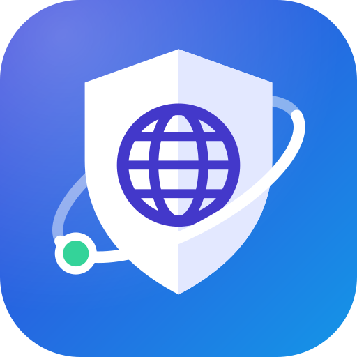

# Free Global VPN (Android)

A native Android VPN app (Kotlin + Jetpack Compose) that connects to **real, free, public VPN servers**
in many countries using **OpenVPN** through Android's `VpnService`.

Developer: **Md. Marufur Rahman Moni**



## Download

**[`apk/FreeGlobalVPN-1.2.0.apk`](apk/FreeGlobalVPN-1.2.0.apk)** – one APK for every phone (Android 7.0+, all CPU types, 13 MB).
Check: `apk/SHA256SUMS.txt`. Signed with a debug key – fine to install yourself; sign with your own key before publishing (docs/BUILD.md).

What's in 1.2.0:
* **One-tap Smart Connect** – the big button measures the best tested servers from your phone and connects to the fastest (automatic failover if one doesn't answer).
* **Only tested-good, secure servers** (see [docs/SERVER_TEST_RESULTS.md](docs/SERVER_TEST_RESULTS.md)); *Update* in Locations or *Developer options → Update servers now* downloads the newest tested list.
* New logo, **Developer options** with the developer's profile, server-list diagnostics and connection log.
* Fixed "There was a problem parsing the package": a single universal APK, minimum Android lowered from 8.0 to 7.0.

## Security

* VPN Gate's stock configs trust the whole Let's Encrypt root **without checking the server name**, so any
  Let's Encrypt certificate would be accepted (man-in-the-middle). The app **pins the certificate name to
  `opengw.net`** and requires a TLS-server certificate.
* Servers are kept only with TLS ≥ 1.2, RSA ≥ 2048 bit, an AES data cipher, and when the test proved they do
  not modify plain-HTTP pages or forge DNS answers.
* Downloaded configs are stripped of script/plugin/management directives; saved profiles are AES-256-GCM
  encrypted with an Android Keystore key; no backups; ics-openvpn's remote-control API is removed.
* Optional: ECDSA signature on the downloadable server list (`FGV_LIST_PUBKEY` + `VERIFIED_LIST_SIGNING_KEY`).
* Honest limits: VPN Gate servers use AES-128-CBC + HMAC-SHA1 (older, not broken), and every VPN Gate
  volunteer shares the same `opengw.net` certificate, so a volunteer could impersonate another volunteer.
  Free volunteer servers are not "no-log".

## Feature list

* One-tap connect / disconnect, **Quick Connect** (smart selection), country & server selection, search
* Favourites (countries + servers), recent connections
* Automatic server **health checks** (TCP latency probe), ranking by latency + uptime + load + recent failures
* **Smart failover**: if a free server doesn't answer within 25 s, the next best one is tried (up to 4)
* **Auto-reconnect** after drops / network changes; waits (instead of failing) while offline
* **DNS leak protection** (forced resolver through the tunnel) and **IPv6 leak blocking**
* "Block traffic while reconnecting" (persistent tun) + guidance for Android's system **kill switch**
* **Split tunnelling for bKash, Nagad, Rocket, CellFin & banks** – these apps bypass the VPN automatically
  (see "Banking apps" below)
* Live notification with status & traffic (provided by the OpenVPN service)
* Import your own OpenVPN configs (e.g. Proton VPN free plan) – stored **encrypted** with an Android Keystore key
* All saved VPN profiles are AES-256-GCM encrypted (Keystore key); app data is excluded from backups
* No accounts, no ads, no analytics, no tracking SDKs
* About screen with the developer's photo and name

## Banking apps (bKash / Nagad / banks) – "auto pause"

Bangladeshi MFS and banking apps often refuse to work over a foreign VPN IP. Instead of switching the
whole VPN off every time you open them (slow, and it would leave other apps exposed), the app uses
Android's per-app VPN exclusion (`VpnService.Builder.addDisallowedApplication`). Excluded apps **always
use your normal Bangladeshi connection** while the VPN stays on for everything else. On first launch the
app pre-selects installed apps it recognises (bKash, Nagad, Rocket, CellFin, banks, anything with
"bank"/"pay"/"wallet" in its name as a suggestion); you can change the list in
**Settings → Apps that bypass the VPN**.

## Honest limitations of free infrastructure

* VPN Gate servers are **volunteer PCs**. They appear and disappear; some are slow; reviewers report
  that a noticeable share of listed servers fail to connect. The app compensates with health checks,
  ranking by uptime, and automatic failover, but it **cannot guarantee** a stable server in every country.
* Most VPN Gate servers are in **Japan and South Korea**, with others in the US, Vietnam, Thailand,
  Russia and elsewhere. Countries like Bangladesh, UAE, Switzerland or Norway are often absent – the app
  then shows them as *Currently unavailable* rather than faking them.
* Logging: VPN Gate keeps connection logs for abuse handling and each operator declares its own logging
  policy (shown per server). **This app never claims "no logs".**
* Free public servers should not be used for sensitive logins; that is another reason banking apps bypass the VPN.

## Project layout

```
app/                      Compose app (UI, server management, VPN controller)
  data/                   models, providers, cache, ranking, settings, encrypted store
  data/provider/          VPN Gate provider + parser, imported-config provider, config sanitiser
  vpn/                    VpnController (engine state machine, failover), IP/DNS/latency probes, speed test, banking-app detection
  ui/                     theme, components (world map, connect button), screens
openvpn/                  Android library module that builds the vendored ics-openvpn sources
  upstream/               ics-openvpn @ commit in UPSTREAM_COMMIT (OpenVPN3/ASIO/mbedTLS removed – not used)
  src/main/java/...       ProfileEncryption.java (Keystore AES-GCM profile encryption)
docs/                     BUILD.md, SERVER_INTEGRATION.md, TESTING.md, PRIVACY_POLICY.md
```

See **docs/BUILD.md** to build the APK.
